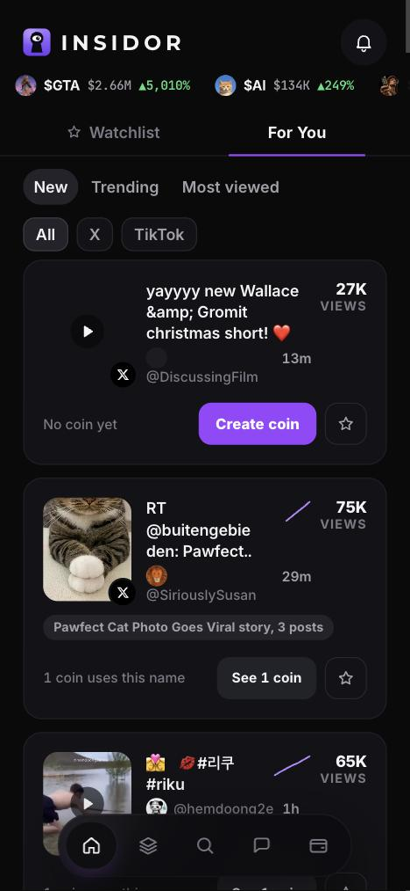
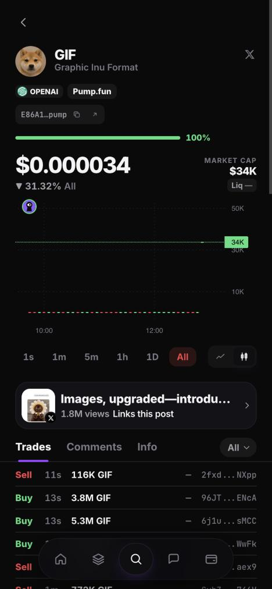
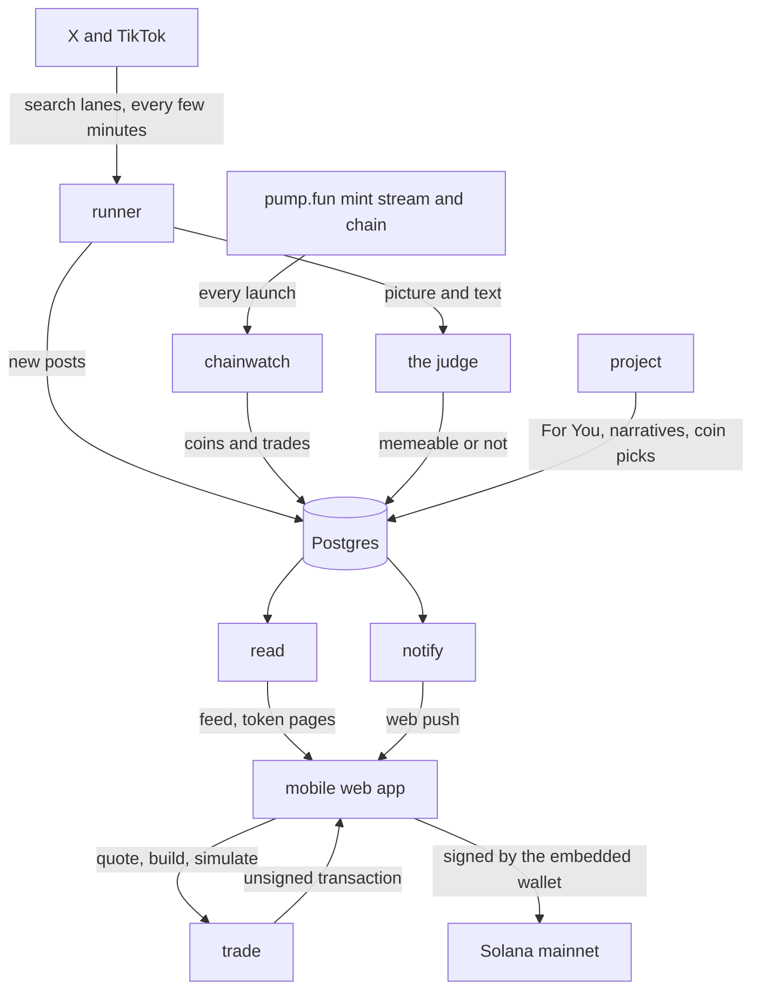

# Insidor

Catch the meme before the coin. A mobile web app that finds viral, memeable posts on X and
TikTok before anyone has launched a coin for them, then tells you which coin for that post is
the one actually running, so you can research it, launch it yourself, or buy it on Solana.

**Live app:** [insidor.app](https://insidor.app)

<p>
  
  
</p>

## The problem

Every viral post on X now gets coined on pump.fun, usually within a minute, by bots. One meme
can spawn hundreds of tokens with the same name. By the time a person sees the post, the
copies are already there, and almost all of them go to zero. The one that runs is rarely the
first one minted.

So the useful questions are not "is there a coin" but:

1. **Which posts are memeable enough to become a coin at all**, found early, in any language.
2. **Which of the coins named after a post is the real one**, and is it actually running.

Insidor answers both, and shows its working: where a fact is unknown the screen says so, and an
absence is a dash with a reason, never a zero.

## What's live

| Feature | Where it lives |
| --- | --- |
| **For You**: memeable posts from X and TikTok, found by our own search lanes, judged by a vision model and sorted by New, Trending and Most viewed | `services/runner`, `services/project`, `mobile/src/features/feed` |
| **The judge**: decides whether a post is memeable from its text and its picture or video, taught from the team's own calls and re-tested against a fixed set of past misses before any change goes live | `adapters/judge`, `core/src/qualify` |
| **Narratives**: posts about the same thing grouped into one story, by words and by the same picture | `core/src/group`, `mobile/src/features/narratives` |
| **One coin per post**: the coins launched for a post matched to it (its link, its picture, its name, the creator's profile), and the one that is running picked. Rival coins racing for the same post are shown as a PvP | `core/src/match`, `services/runner/src/work/one-coin.ts` |
| **Token page**: the chart from the pool the coin really trades in (including coins paired with tokenized stocks), the post it came from, live trades, comments and info | `services/read`, `services/market`, `mobile/src/features/token` |
| **Trading**: buy and sell from an embedded wallet, on the pump.fun curve or through Jupiter, every transaction simulated before it is signed | `services/trade`, `adapters/venue`, `wallet-embedded`, `mobile/src/features/trade` |
| **Create a coin** for a post that has none yet | `mobile/src/features/create` |
| **Portfolio and profiles**: holdings, deposit, follow people and see their trades | `mobile/src/features/portfolio`, `services/social` |
| **Alerts**: a push only when a coin launched after we found the post and is actually running, plus alerts for posts you watch | `services/notify` |
| **Account safety**: posts from old accounts emptied and dressed up as an official organisation are kept off the feed | `core/src/admit/reskin.ts` |

The server never holds a private key. It prices a trade, builds an unsigned transaction,
simulates it, and hands it to the wallet to sign.

## How it works



| Piece | Role |
| --- | --- |
| `services/runner` | Finds posts (X and TikTok search lanes, watched accounts, coin links) and judges them |
| `services/chainwatch` | Follows every pump.fun launch and its trades |
| `services/project` | Builds For You, groups narratives and picks the coin for each post |
| `services/read` | The app's read API: feed, token pages, search |
| `services/market` | Prices, candles and pools |
| `services/trade` | Quotes, builds and simulates trades; sends signed ones |
| `services/social` | Profiles, follows, comments, invites |
| `services/notify` | Alerts and web push |
| `mobile` | The app (React, Vite), deployed on Vercel |

## The layout

Each folder is one job, and the boundaries are enforced by the build:

| Folder | What it holds |
| --- | --- |
| `contracts/` | The shared vocabulary: every type, every port an adapter must fill, and every threshold in one policy file |
| `core/` | The logic, pure: no clock, no network, no randomness, so every decision can be replayed |
| `adapters/` | The outside world: each platform, chain, market, judge and wallet behind a port |
| `store/` | The database: numbered migrations and repositories |
| `services/` | The running processes listed above |
| `mobile/` | The app, split by feature under `src/features/` |
| `wallet/`, `wallet-embedded/` | What a browser may do with a wallet, and the embedded wallet itself |
| `eval/`, `ml/`, `e2e/` | Labelled sets, model training, and end-to-end tests against a real database |
| `tools/` | Checks, migrations and the operator's scripts |

`pnpm check` runs the rules that keep this honest, and fails the build on any of them:

- no platform or vendor word in `contracts/` or `core/`
- no clock, network or bare number in `core/`
- none of the system's internal words on the app's screens
- no import across the boundaries: `core` never imports an adapter, the app never imports `core`

## Run it

```bash
corepack enable
pnpm install
pnpm check
```

`SETUP.md` covers the database, what runs on free data, and which keys turn on which source.
`DEPLOY.md` and `docs/deploy-railway-vercel.md` cover the deploy (Railway for the services,
Vercel for the app).
